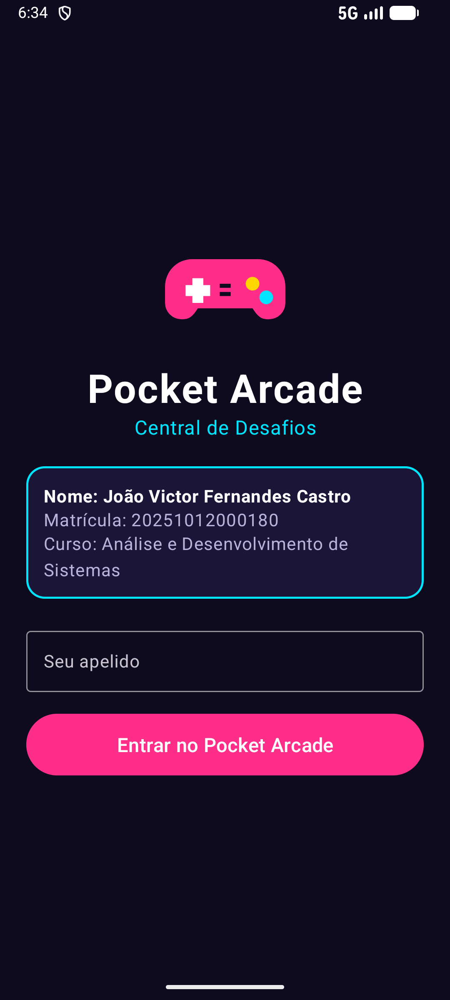
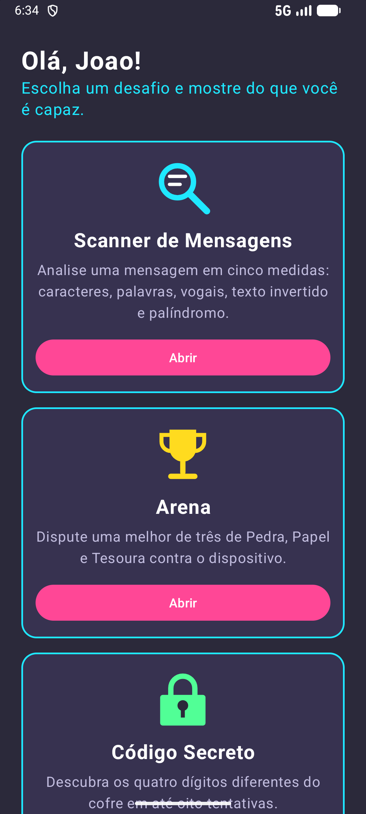
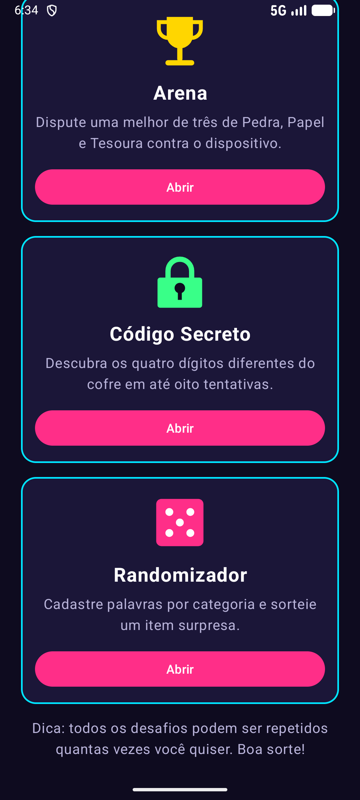
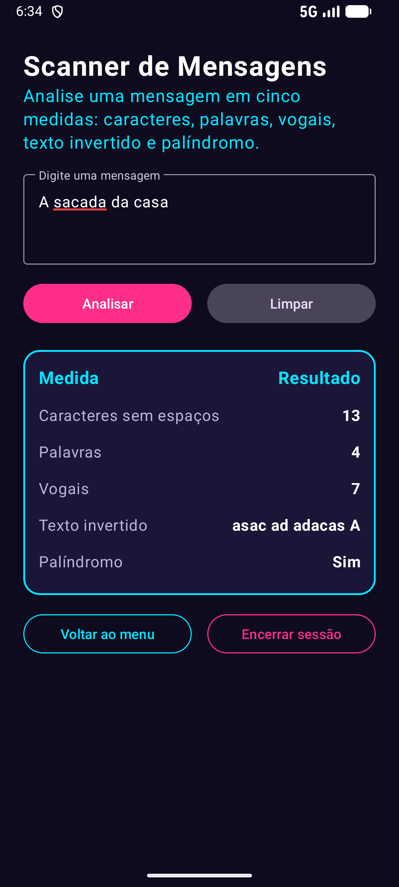
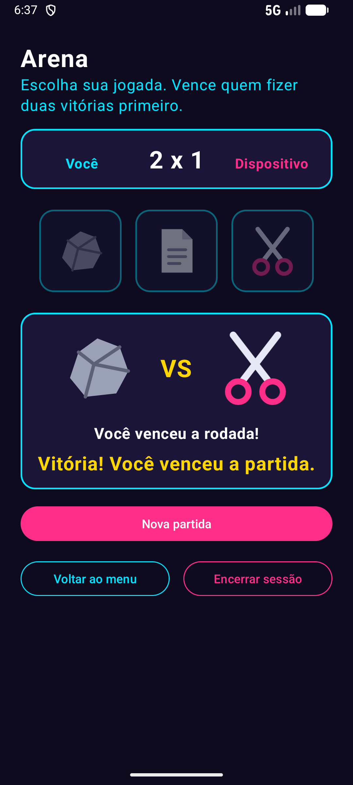
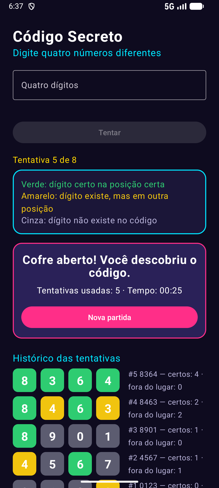
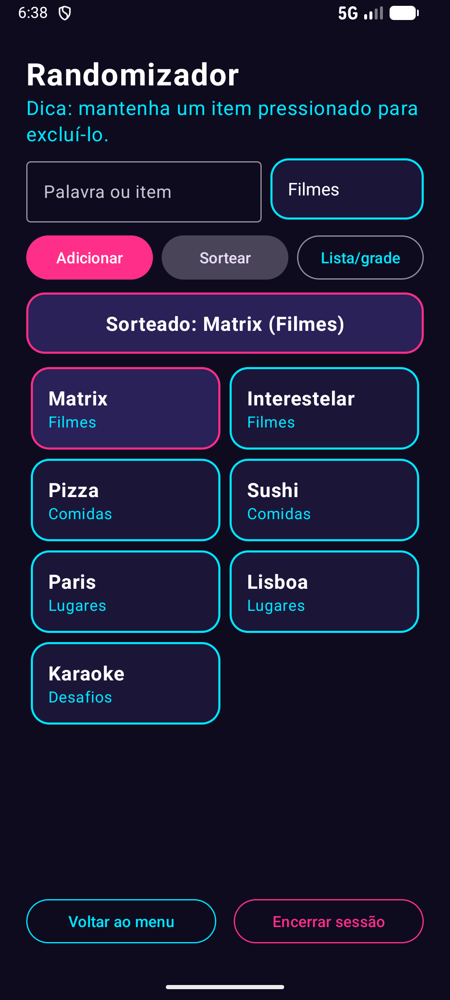
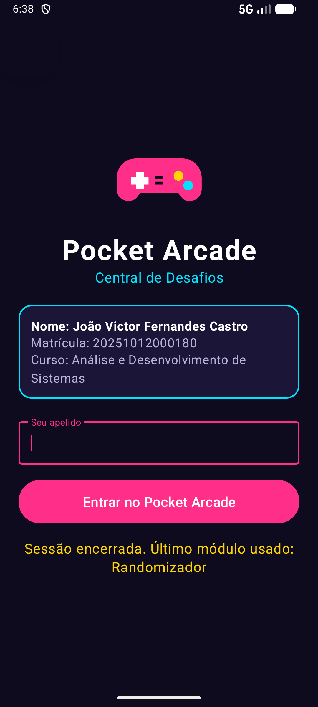
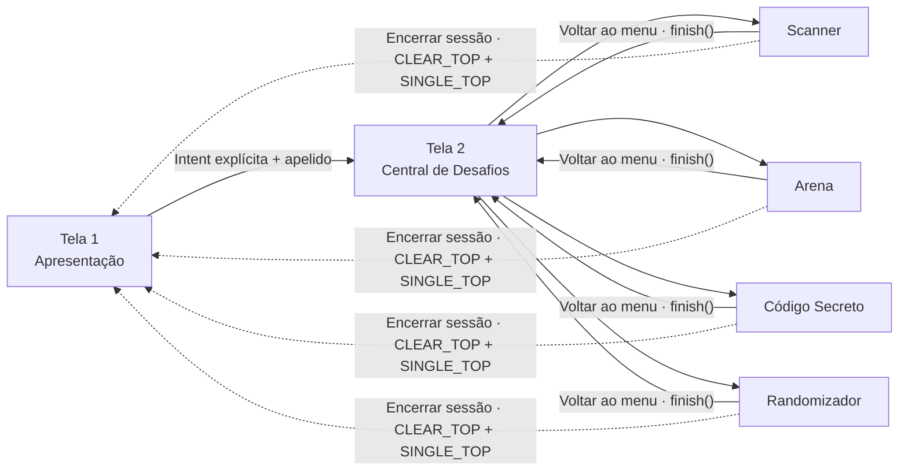

<div align="center">



# 🎮 Pocket Arcade

### Central de Desafios para Android

Quatro minijogos e ferramentas em um só app: analise textos, enfrente o dispositivo, quebre o código do cofre e sorteie itens por categoria.


</div>

---

## ✨ Sobre o projeto

O **Pocket Arcade** é um aplicativo Android nativo (Java + XML) que reúne, em um único projeto, os conteúdos estudados na disciplina de **Desenvolvimento de Aplicações para Dispositivos Móveis**: formulários e validações, layouts e rolagem, navegação entre Activities, ciclo de vida, `MediaPlayer`, animações e `RecyclerView`.

São **seis telas** e **quatro desafios interativos**, todos funcionando offline, sem banco de dados e sem internet.

## 📱 Telas do aplicativo

<table align="center">
  <tr>
    <td align="center"><br><b>1 · Apresentação</b><br><sub>Identificação e apelido validado</sub></td>
    <td align="center"><br><b>2 · Central de Desafios</b><br><sub>Menu rolável com animação de entrada</sub></td>
    <td align="center"><br><b>2 · Central (rolagem)</b><br><sub>Quatro painéis de desafio</sub></td>
  </tr>
  <tr>
    <td align="center"><br><b>3 · Scanner de Mensagens</b><br><sub>Cinco medidas sobre o texto</sub></td>
    <td align="center"><br><b>4 · Arena</b><br><sub>Pedra, Papel e Tesoura, melhor de três</sub></td>
    <td align="center"><br><b>5 · Código Secreto</b><br><sub>Pistas coloridas e histórico</sub></td>
  </tr>
  <tr>
    <td align="center"><br><b>6 · Randomizador</b><br><sub>RecyclerView em grade com sorteio</sub></td>
    <td align="center"><br><b>Encerrar sessão</b><br><sub>Volta à Tela 1 e lembra o último módulo</sub></td>
    <td></td>
  </tr>
</table>

## 🕹️ Os desafios

### 🔍 Scanner de Mensagens
Digite um texto (mínimo de 3 caracteres) e veja cinco medidas: **caracteres sem espaços**, **palavras**, **vogais** (acentos contam), **texto invertido** e se é um **palíndromo**, ignorando espaços e maiúsculas. Exemplos: `Ana` e `A sacada da casa`.

### 🪨📄✂️ Arena
Pedra, Papel e Tesoura contra o dispositivo, **melhor de três**: vence quem fizer duas vitórias primeiro e empates não pontuam. As escolhas e o resultado são animados e cada rodada tem um efeito sonoro de vitória, derrota ou empate.

### 🔐 Código Secreto
O cofre esconde **quatro dígitos diferentes** e você tem até **oito tentativas**. Cada dígito recebe uma cor, inspirada no TERMO:

| Cor | Significado |
|---|---|
| 🟩 Verde | Dígito certo na posição certa |
| 🟨 Amarelo | O dígito existe, mas em outra posição |
| ⬜ Cinza | O dígito não existe no código |

Ao final, o app mostra vitória ou derrota, a quantidade de tentativas e o **tempo decorrido**.

### 🎲 Randomizador
Cadastre palavras em categorias (**Filmes, Comidas, Lugares e Desafios**), alterne entre **lista e grade** e sorteie um item apenas da categoria selecionada. Itens são removidos com **clique longo**.

## 🧭 Fluxo de navegação



## 🛠️ Tecnologias

| Recurso | Uso no projeto |
|---|---|
| **Java 17 + XML** | Código e layouts de todas as telas |
| **View Binding** | Acesso às views, sem `findViewById` |
| **ConstraintLayout, LinearLayout, NestedScrollView** | Estrutura e rolagem das telas |
| **RecyclerView + Adapter + ViewHolder** | Lista/grade do Randomizador com `LinearLayoutManager` e `GridLayoutManager` |
| **Intents explícitas e flags** | Navegação, extras e retorno sem duplicar telas |
| **MediaPlayer** | Efeitos sonoros locais em `res/raw` |
| **Animações XML e ViewPropertyAnimator** | Entrada dos painéis, resultados e feedbacks |
| **Material Components** | Campos de texto e botões no tema escuro |

## 📂 Estrutura do projeto

```text
app/src/main/
├── java/com/pocketarcade/app/
│   ├── ApresentacaoActivity.java     # Tela 1
│   ├── CentralActivity.java          # Tela 2
│   ├── ScannerActivity.java          # Tela 3
│   ├── ArenaActivity.java            # Tela 4
│   ├── CodigoSecretoActivity.java    # Tela 5
│   ├── RandomizadorActivity.java     # Tela 6
│   ├── ItemSorteio.java              # Modelo
│   ├── ItemSorteioAdapter.java       # Adapter + ViewHolder
│   ├── Navegacao.java                # Extras e encerrar sessão
│   └── JanelaUtil.java               # Insets das barras do sistema
└── res/
    ├── layout/   anim/   drawable/   raw/   values/
tools/gerar_sons.js                   # Gera os efeitos sonoros
docs/screenshots/                     # Capturas deste README
```

## ▶️ Como executar

**Pelo Android Studio:** abra a pasta do projeto, aguarde a sincronização do Gradle e clique em **Run**.

**Pela linha de comando:**

```bash
./gradlew assembleDebug
```

O APK é gerado em `app/build/outputs/apk/debug/app-debug.apk`.

> Requisitos: Android Studio recente com SDK 37 instalado e JDK 17 ou superior. O app roda no Android 8.0 (API 26) ou mais novo.

## 🎨 Créditos

- **Ícones e logotipo:** vetores em XML desenhados para este projeto.
- **Efeitos sonoros:** sintetizados por código em [`tools/gerar_sons.js`](tools/gerar_sons.js); nenhum material de terceiros foi utilizado.

## 👤 Autor

**João Victor Fernandes Castro**
Análise e Desenvolvimento de Sistemas · Matrícula 20251012000180

Trabalho avaliativo da disciplina de Desenvolvimento de Aplicações para Dispositivos Móveis — Prof. Fernando Gonçalves Abadia.
